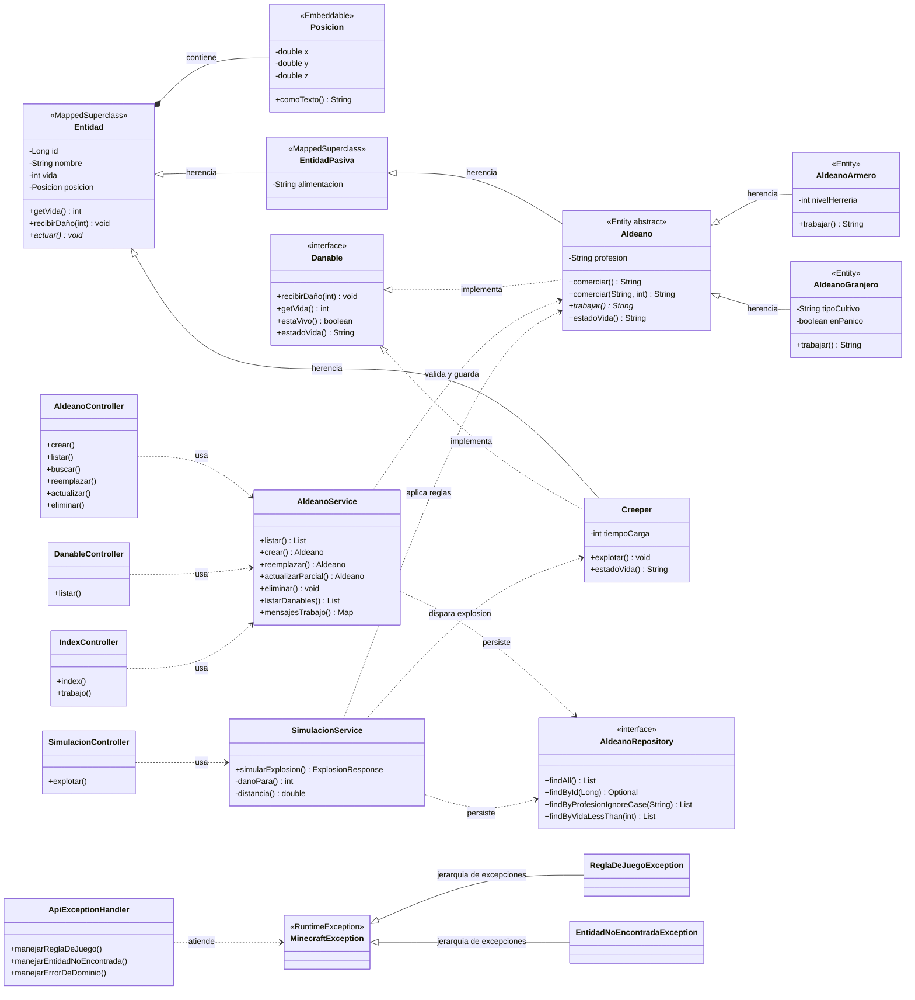

# arar-taller-git-2026 — POO-08 + POO-09: CRUD REST, H2, reglas de juego, excepciones y OpenAPI

Servicio HTTP con Spring Boot sobre el modelado de **Minecraft**. Persiste en **H2** la familia de los aldeanos, expone un CRUD REST completo, ejecuta una simulación de explosión con dos reglas de negocio, traduce una jerarquía de excepciones del dominio a respuestas HTTP distintas y publica su contrato con **OpenAPI 3.1 y Swagger UI**.

- **Autor:** Alexandre Avalos (`duw4ng`)
- **Dominio:** Minecraft
- **Spring Boot:** 4.1.1 · **springdoc-openapi:** 3.1.1 · **Java:** 21
- **Contrato:** `/v3/api-docs` (JSON), `/v3/api-docs.yaml` (YAML), `/swagger-ui.html` (UI)
- **Licencia:** Apache 2.0 (ver [`LICENSE`](LICENSE))
- **Commit de la solución:** <https://github.com/duw4ng/arar-taller-git-2026/commit/2f29708979225397823ab90c27447032bca4536a>
- **Enunciado:** <https://github.com/alefq/afq-taller-git-2024/blob/main/docs/ejercicio-poo-08-crud-h2-insomnia-2026-10-28.md>
- **Rúbrica:** <https://github.com/alefq/afq-taller-git-2024/blob/main/docs/RUBRICA-ejercicios-lp3-2026.md>

---

## POO-08 en esta entrega

La corrección recibida fue **18/24** (nota **7,5/10**), con observaciones en los criterios 2, 3 y 8. Están todas cerradas en el estado actual del repositorio, en los commits [`f837d12`](https://github.com/duw4ng/arar-taller-git-2026/commit/f837d12) y [`6eca763`](https://github.com/duw4ng/arar-taller-git-2026/commit/6eca763).

| Criterio | Observación | Cierre |
|---|---|---|
| Organización en paquetes | `IndexController` y `DanableController` llamaban al repositorio directamente. | Ambos controllers dependen sólo de `AldeanoService`; el repositorio se usa únicamente desde los services. |
| Organización en paquetes | El dominio lanzaba excepciones y contenía reglas de negocio. | Validaciones, reglas y excepciones viven en `AldeanoService`, `SimulacionService` y `PosicionParser`; las entidades sólo guardan estado. |
| Ocultamiento e invariantes | La posición era un `String` libre y se podían guardar coordenadas como `"abc"`. | `Posicion` es `@Embeddable` con `double x`, `double y`, `double z` en columnas numéricas, validada en el service. |
| Ocultamiento e invariantes | Un `PATCH` podía revivir un aldeano con vida `0`. | `AldeanoService` rechaza devolver vida a un aldeano muerto. |
| Documentación | El README decía que el controller hacía la simulación y el Mermaid lo unía a `AldeanoRepository`. | Ambos reflejan que `SimulacionController` delega en `SimulacionService`. |
| Documentación | Faltaba mencionar la licencia en el README. | El README indica Apache 2.0 y enlaza `LICENSE`. |

El puntaje publicado no se vuelve a calificar con la rúbrica de 24; esta tabla deja constancia del cierre de cada observación.

## 1. Cómo arrancar

```bash
./mvnw spring-boot:run
```

El servicio queda en <http://localhost:8082>. La colección de Insomnia se importa desde `insomnia/POO-08-arar-taller-git-2026.json`.

Con el servicio levantado, el contrato y la UI están en:

- JSON: <http://localhost:8082/v3/api-docs>
- YAML: <http://localhost:8082/v3/api-docs.yaml>
- Swagger UI: <http://localhost:8082/swagger-ui.html>

Comandos útiles:

```bash
./mvnw test          # prueba de contexto de Spring y generación del contrato JSON/YAML
./mvnw clean package # empaqueta target/arar-taller-git-2026-0.0.1-SNAPSHOT.jar
```

Para borrar los datos locales de H2, detener la aplicación y eliminar la carpeta `data/`.

---

## 2. Propiedades de H2 explicadas

Archivo: `src/main/resources/application.properties`.

| Propiedad | Valor | Qué significa |
|---|---|---|
| `spring.datasource.url` | `jdbc:h2:file:./data/entidades` | Base H2 en archivo, relativa al directorio del proyecto. El estado sobrevive a los reinicios. |
| `spring.datasource.username` | `sa` | Usuario de desarrollo de H2. |
| `spring.datasource.password` | vacío | H2 local sin contraseña; sólo para el taller. |
| `spring.datasource.driver-class-name` | `org.h2.Driver` | Driver JDBC que usa Spring para hablar con H2. |
| `spring.jpa.hibernate.ddl-auto` | `update` | Hibernate crea o actualiza las tablas según las entidades, sin borrar los datos existentes. |
| `spring.jpa.open-in-view` | `false` | La sesión JPA se cierra al terminar el servicio; evita consultas perezosas desde la vista y obliga a persistir dentro de la transacción. |
| `spring.jpa.show-sql` | `false` | No imprime el SQL generado. Se puede poner en `true` para depurar. |
| `spring.h2.console.enabled` | `true` | Habilita la consola web de H2. |
| `spring.h2.console.path` | `/h2-console` | URL de la consola. |

**Consola H2:** abrir <http://localhost:8082/h2-console>, usar `jdbc:h2:file:./data/entidades`, usuario `sa` y contraseña vacía. La tabla persistida se llama `aldeanos`. En Spring Boot 4 la consola ya no sale del driver H2: requiere la dependencia explícita `org.springframework.boot:spring-boot-h2console` (ver `pom.xml`); sin ese módulo las propiedades se ignoran y `/h2-console` da 404.

**Si mañana se cambia H2 por otra base:** se tocan `pom.xml` (driver), `application.properties` (URL, usuario, contraseña y dialecto) y, si se usa, la herramienta de migraciones. Las entidades, el repositorio, los servicios con las reglas, los controllers y los DTOs se quedan quietos.

---

## 3. Las tres clases persistidas y la interfaz

La familia persistida es:

- `Aldeano` — clase base abstracta, entidad JPA.
- `AldeanoArmero` — hija concreta, entidad JPA.
- `AldeanoGranjero` — hija concreta, entidad JPA.

La relación «es un» se mantiene: un armero y un granjero **son** aldeanos. El método abstracto `trabajar()` de POO-06 sigue existiendo y cada hija lo sobrescribe. La posición se modela con `Posicion`, un `@Embeddable` de tres coordenadas `double` (`x`, `y`, `z`), para que la base no pueda guardar texto libre como `"abc"`.

La interfaz de dominio es **`Danable`**:

```java
public interface Danable {
    void recibirDaño(int cantidad);
    int getVida();
    boolean estaVivo();
    String estadoVida();
}
```

La implementan `Aldeano` (familia pasiva) y `Creeper` (familia hostil). El endpoint `GET /minecraft/danables` habla con el tipo `Danable`, no con las clases concretas.

### Diagrama Mermaid



Lectura del diagrama:

- **Herencia:** `Entidad → EntidadPasiva → Aldeano → AldeanoArmero/AldeanoGranjero`; `Entidad → Creeper`.
- **Composición:** `Entidad` contiene una `Posicion` embebida con tres coordenadas numéricas; se persiste en `posicion_x`, `posicion_y` y `posicion_z`.
- **Implementación de interfaz:** `Aldeano` y `Creeper` implementan `Danable`.
- **Uso del repositorio:** sólo los services (`AldeanoService` y `SimulacionService`) dependen de `AldeanoRepository`; los controllers dependen únicamente de services.
- **Validaciones y reglas:** las validaciones y el parseo de la posición están en `AldeanoService`; las dos reglas de la explosión están en `SimulacionService`. Las entidades sólo guardan estado.
- **Jerarquía de excepciones:** `MinecraftException` es la base; `ReglaDeJuegoException` y `EntidadNoEncontradaException` son las hijas; `ApiExceptionHandler` atiende un tipo por método.

Por claridad, el diagrama muestra a `Creeper` colgando directamente de `Entidad`. En el código, `Creeper` hereda de `Entidad` a través de la clase abstracta `EntidadHostil`, que aporta los campos `daño` y `objetivo`.

---

## 4. API REST

| Método | URL | Qué hace | Éxito | Efecto en H2 |
|---|---|---|---|---|
| `GET` | `/` | Confirma que el servicio vive. | `200` | Ninguno |
| `GET` | `/minecraft/trabajo` | Lista los mensajes polimórficos de `trabajar()` de lo persistido. | `200` | Ninguno |
| `POST` | `/minecraft/aldeanos` | Crea un aldeano; el `tipo` del JSON elige la hija. | `201 Created` | **Inserta** |
| `GET` | `/minecraft/aldeanos` | Lista la colección persistida. Acepta `?profesion=Armero`. | `200` | Ninguno |
| `GET` | `/minecraft/aldeanos/{id}` | Lee un aldeano por su id. | `200` / `404` | Ninguno |
| `PUT` | `/minecraft/aldeanos/{id}` | Reemplaza el recurso entero. El tipo no puede cambiar. | `200` | **Reemplaza** |
| `PATCH` | `/minecraft/aldeanos/{id}` | Actualiza sólo los campos presentes. | `200` | **Actualiza** |
| `DELETE` | `/minecraft/aldeanos/{id}` | Borra físicamente la fila. | `204 No Content` | **Borra** |
| `GET` | `/minecraft/danables` | Endpoint que usa la interfaz `Danable`. | `200` | Ninguno |
| `POST` | `/minecraft/simulaciones/explosion` | Ejecuta y persiste la simulación de explosión. | `200` | **Escribe**: `saveAll` guarda la vida nueva de todos los aldeanos |
| `GET` | `/minecraft/escenarios/diagnostico` | Primer contacto leyendo `/v3/api-docs` de A2 y A3. | `200` | Ninguno |
| `POST` | `/minecraft/escenarios/explosiones-cruzadas` | Orquesta A2 y A3; guarda la jugada sólo si ambos aceptan. | `201` / `502` | **Escribe**: inserta en `jugadas_cruzadas` sólo con doble aceptación |
| `GET` | `/minecraft/escenarios/explosiones-cruzadas` | Lista las jugadas cruzadas ya persistidas. | `200` | Ninguno |
| `GET` | `/h2-console` | Consola web de H2. | UI | Ninguno |

### 4.1 Contrato OpenAPI y Swagger UI

La misma API está descrita en OpenAPI 3.1.0; los DTOs, las entidades polimórficas, los cuerpos, las restricciones, los ejemplos y los códigos de error salen de las anotaciones de los controllers y DTOs.

| Recurso | URL | Uso |
|---|---|---|
| JSON | `GET /v3/api-docs` | Contrato completo para clientes o generadores de código. |
| YAML | `GET /v3/api-docs.yaml` | El mismo contrato en YAML. |
| Swagger UI | `GET /swagger-ui.html` | Interfaz interactiva; redirige a `/swagger-ui/index.html`. |

El `info.description` del contrato y la operación de simulación repiten la tabla de efectos en H2: `POST`/`PUT`/`PATCH`/`DELETE` de aldeanos y `POST /minecraft/simulaciones/explosion` escriben; los `GET` sólo leen. La simulación **no** se presenta como una validación sin efectos.

Ejemplo de creación:

```json
{
  "tipo": "ARMERO",
  "nombre": "Pedro",
  "vida": 20,
  "posicion": "5,64,0",
  "alimentacion": "Carne",
  "nivelHerreria": 3
}
```

El `id` **no** viaja en el JSON de creación: lo asigna H2/JPA y aparece en la respuesta y en la cabecera `Location`.

Para un granjero:

```json
{
  "tipo": "GRANJERO",
  "nombre": "Juan",
  "vida": 25,
  "posicion": "20,64,0",
  "alimentacion": "Pan",
  "tipoCultivo": "Trigo"
}
```

`PUT` exige todos los campos de base más el campo de la hija. `PATCH` sólo aplica los campos no nulos; un campo omitido conserva el valor anterior.

### 4.2 POO-09 — APIs cruzadas (A1/A2/A3)

| Rol | Responsable | Servicio | Regla que aporta | Efecto en su H2 |
|---|---|---|---|---|
| **A1** | Alexandre Avalos | este repositorio, puerto `8082`, OpenAPI <http://localhost:8082/v3/api-docs> | orquesta el escenario y guarda la jugada | **Inserta** en `jugadas_cruzadas` sólo si A2 y A3 aceptan |
| **A2** | Elias Pont | <https://github.com/eliasleonardo11-dotcom/EP-taller-git-2026>, commit [`15f97c7`](https://github.com/eliasleonardo11-dotcom/EP-taller-git-2026/commit/15f97c7), puerto `8080`, OpenAPI <http://localhost:8080/v3/api-docs> | Creeper y Zombie vivos, `0 <= distancia <= rango`; daño `max(1, 12 - 3 * distancia)`; Creeper queda en vida `0` | su H2 cambia cuando acepta |
| **A3** | Marcelo Romero | <https://github.com/mnri1904/mnri-taller-git-2026>, commit [`6ccc6ea`](https://github.com/mnri1904/mnri-taller-git-2026/commit/6ccc6ea06c82cc5fb684b8d299ec82cc55e0721d), puerto `8081`, OpenAPI <http://localhost:8081/v3/api-docs> | Creeper vivo detona una vez; daño `12 - 3 * floor(distancia)` a Zombies y Cerdos a `<= 3` bloques | su H2 cambia cuando acepta |

Configuración previa (los valores por defecto ya apuntan a los puertos acordados; las variables sólo sirven para sobrescribirlos):

```bash
export ELIAS_API_URL=http://localhost:8080
export MARCELO_API_URL=http://localhost:8081
export PORT=8082
./mvnw spring-boot:run
```

Para levantar los tres servicios desde sus commits, en tres terminales distintas (si no están en la misma máquina, reemplazar `localhost` por la IP correspondiente en las variables de A1):

```bash
# A1 — Alexandre
git clone https://github.com/duw4ng/arar-taller-git-2026.git && cd arar-taller-git-2026
git checkout 2f29708979225397823ab90c27447032bca4536a
./mvnw spring-boot:run

# A2 — Elias
git clone https://github.com/eliasleonardo11-dotcom/EP-taller-git-2026.git && cd EP-taller-git-2026
git checkout 15f97c7
./mvnw spring-boot:run

# A3 — Marcelo
git clone https://github.com/mnri1904/mnri-taller-git-2026.git && cd mnri-taller-git-2026
git checkout 6ccc6ea06c82cc5fb684b8d299ec82cc55e0721d
./mvnw spring-boot:run
```

El primer contacto con cada API es leer su OpenAPI:

```bash
curl http://localhost:8082/minecraft/escenarios/diagnostico
```

Escenario feliz (los ids deben existir previamente en A2 y A3):

```bash
curl -X POST http://localhost:8082/minecraft/escenarios/explosiones-cruzadas \
  -H 'Content-Type: application/json' \
  -d '{"creeperEliasId":1,"zombieEliasId":2,"distanciaElias":1,"creeperMarceloId":1}'
```

Si los dos devuelven `200`, A1 responde `201` y la fila queda en `GET /minecraft/escenarios/explosiones-cruzadas`. Si uno rechaza, A1 responde `502 COMPANERO_RECHAZO` con `origen` (`A2 Elias` o `A3 Marcelo`), `estadoCompanero` y `codigoCompanero`; **A1 no guarda nada**. Los rechazos traducidos son `FUERA_DE_ALCANCE` de A2 y `ENTIDAD_DESAPARECIDA`/`EXPLOSION_INVALIDA` de A3. Aviso: A2 y A3 sí consumen sus entidades cuando aceptan, así que un reintento necesita ids nuevos en esos servicios.

Si alguna variable se define vacía → `503 COMPANERO_NO_CONFIGURADO`.

Entregables relacionados: `docs/especificaciones-poo-09.md`, `docs/respuestas-ejemplo-poo-09.md` e `insomnia/POO-09-arar-taller-git-2026.json`.

---

## 5. Las dos reglas de negocio

1. **Onda expansiva:** el daño que produce un Creeper es `potencia - distancia` (redondeado, nunca negativo) y es `0` para todo aldeano que esté fuera del radio de la explosión.
2. **Mitigación por oficio:** el armero reduce el daño en `nivelHerreria * 2` por su armadura, mientras que el granjero recibe el daño completo y, si sobrevive, queda marcado con `enPanico = true`.

Las dos reglas viven en `SimulacionService`:

- `simularExplosion` calcula la onda expansiva: `potencia - distancia`, nunca negativa y `0` fuera del radio.
- `danoPara` aplica la mitigación por oficio: al armero le resta `nivelHerreria * 2`; el granjero recibe el daño completo y, si sobrevive y recibió daño, queda con `enPanico = true`.

El `SimulacionController` sólo delega la petición en `SimulacionService`. El service recorre los aldeanos persistidos, aplica las reglas, guarda el estado y devuelve el resultado. El `GET /minecraft/aldeanos` posterior muestra la vida nueva y el `enPanico` del granjero.

Ejemplo de simulación **aceptada** (`200`):

```json
{
  "potencia": 30,
  "radio": 30,
  "posicionCreeper": "0,64,0",
  "tiempoCarga": 3
}
```

Con un armero de nivel 2 a 5 bloques recibe `25 - (2 * 2) = 21` de daño y un granjero a 25 bloques recibe `5`; si el granjero sobrevive queda `enPanico = true`. Esa vida se guarda con `repository.saveAll(aldeanos)`: **la simulación modifica H2**, no es una validación sin efectos. El `GET /minecraft/aldeanos` posterior muestra el estado persistido.

Ejemplo **rechazado** (`400 REGLA_DE_JUEGO`):

```json
{
  "potencia": 0,
  "radio": 30,
  "tiempoCarga": 3
}
```

Se rechaza porque `SimulacionService` exige `potencia > 0`; en ese caso no se guarda nada. El contrato expone ambos ejemplos en el `requestBody` de `POST /minecraft/simulaciones/explosion`, junto con un ejemplo de respuesta `200` y otro de error `400`.

---

## 6. Jerarquía de excepciones y handlers

| Excepción | Situación | Handler | HTTP | `tipo` en el JSON |
|---|---|---|---|---|
| `MinecraftException` | Base del dominio; fallback. | `manejarErrorDeDominio` | `400` | `ERROR_DE_DOMINIO` |
| `ReglaDeJuegoException` | Se viola un invariante o una regla del juego. | `manejarReglaDeJuego` | `400` | `REGLA_DE_JUEGO` |
| `EntidadNoEncontradaException` | No existe el recurso pedido. | `manejarEntidadNoEncontrada` | `404` | `ENTIDAD_NO_ENCONTRADA` |
| `EliasRechazoException` / `MarceloRechazoException` | A2 o A3 rechazó el escenario. | `manejarRechazoDeCompanero` | `502` | `COMPANERO_RECHAZO` (con `origen`) |
| `CompaneroNoConfiguradoException` | Falta alguna URL base de compañero. | `manejarCompaneroNoConfigurado` | `503` | `COMPANERO_NO_CONFIGURADO` |

El JSON de error tiene esta forma:

```json
{
  "tipo": "REGLA_DE_JUEGO",
  "mensaje": "El nivel de herrería debe estar entre 1 y 5.",
  "estado": 400,
  "ruta": "/minecraft/aldeanos",
  "marcaTemporal": "2026-11-08T01:18:53.661289486"
}
```

Las excepciones son **no comprobadas** (`RuntimeException`). Las lanza la capa service al validar datos o reglas; las entidades no lanzan excepciones. El `@RestControllerAdvice` las convierte en HTTP. Las hermanas se distinguen por el código (`400`/`404`) y por el campo `tipo`.

Para el challenge POO-09, un rechazo de compañero agrega el origen:

```json
{
  "tipo": "COMPANERO_RECHAZO",
  "origen": "A2 Elias",
  "mensaje": "A2 (Elias) rechazó la explosión [FUERA_DE_ALCANCE]: ...",
  "estado": 502,
  "estadoCompanero": 422,
  "codigoCompanero": "FUERA_DE_ALCANCE",
  "ruta": "/minecraft/escenarios/explosiones-cruzadas",
  "marcaTemporal": "2026-11-22T22:11:00.123456"
}
```

---

## 7. Sobrecarga y sobreescritura

### Sobreescritura (`@Override`, enlace dinámico en tiempo de ejecución)

- `trabajar()`: declarado abstracto en `Aldeano`, sobrescrito en `AldeanoArmero` y `AldeanoGranjero`. El service lo invoca sobre `List<Aldeano>` sin conocer la hija.
- `actuar()`: declarado en `Entidad`, sobrescrito en `Aldeano`, `Creeper`, `Jugador`, `Zombie`, `Esqueleto`, `Enderman` y `Cerdo`.
- `estadoVida()`: contrato de `Danable`; `Aldeano` y `Creeper` lo implementan con mensajes propios.

### Sobrecarga (misma clase, distinta firma, enlace estático en tiempo de compilación)

- **Constructores:** cada hija tiene un constructor sin argumentos `protected` para JPA, un constructor simple con algunos valores por defecto y un constructor completo con todos los datos.
- **Mensaje de dominio `comerciar()`:** `comerciar()` y `comerciar(String item, int cantidad)` en `Aldeano`.

| Criterio | Sobrecarga | Sobreescritura |
|---|---|---|
| Relación | Misma clase o jerarquía. | Requiere herencia. |
| Firma | Cambia la lista de parámetros. | Idéntica (nombre, parámetros, retorno). |
| Resolución | Compilación (*static binding*). | Ejecución (*dynamic binding*). |
| Anotación | No usa `@Override`. | Usa `@Override`. |
| Ejemplo | Constructores de `AldeanoArmero`/`AldeanoGranjero`; `comerciar()`. | `trabajar()` y `estadoVida()`. |

**Visibilidad del constructor vacío:** el constructor sin argumentos que necesita JPA se declara `protected` y delega en un estado completo con `this(...)`. Los constructores de negocio son `public`. Las validaciones no viven en las entidades: `AldeanoService` valida los datos y `PosicionParser` convierte la posición textual en coordenadas numéricas antes de construir la entidad.

---

## 8. Respuestas a «Qué hay que pensar»

**Recurso y verbo.** El sustantivo de la API es `aldeano`; la colección vive en `/minecraft/aldeanos` y el verbo HTTP dice la operación (`POST`, `GET`, `PUT`, `PATCH`, `DELETE`). La simulación es un recurso de proceso: `POST /minecraft/simulaciones/explosion`.

**Identidad.** La clave es `id`, un `Long` generado por la base con `GenerationType.IDENTITY`. Lo asigna H2/JPA; el JSON de creación lo omite y la respuesta lo incluye.

**Herencia y tablas.** Se eligió `InheritanceType.SINGLE_TABLE` con la columna discriminadora `tipo_aldeano`. La familia es chica, las hijas agregan pocos campos y casi todas las consultas piden «todos los aldeanos»; una sola tabla evita joins y mantiene el CRUD simple. En el JSON el subtipo se distingue con la propiedad `tipo`, agregada por Jackson con `@JsonTypeInfo` y `@JsonSubTypes` (`ARMERO`/`GRANJERO`).

**Interfaz y repositorio.** `AldeanoRepository` es una interfaz de Spring Data: se declaran los mensajes (`findAll`, `findById`, `findByProfesionIgnoreCase`, `findByVidaLessThan`) y el marco genera la implementación. El servicio depende del tipo interfaz, no de una clase concreta, así que puede probarse con un doble o cambiar de persistencia sin tocar el controller. Es la misma idea de POO-07: un contrato con mensajes, y alguien más pone la implementación.

**Protocolo del dominio.** La interfaz propia es `Danable`, con `recibirDaño`, `getVida`, `estaVivo` y `estadoVida`. La usan `Aldeano` (familia pasiva) y `Creeper` (familia hostil), y el endpoint `GET /minecraft/danables` la recorre como `List<Danable>`. Sí puede hablar con instancias de familias distintas: en la respuesta conviven armeros, granjeros y un Creeper.

**Ocultamiento.** Los atributos son `private` y las validaciones viven en la capa service, no en las entidades. `AldeanoService.validarDatosBase` exige `nombre`, `alimentacion` y una posición válida; `nivelHerreria` sólo acepta `1..5`; `tipoCultivo` no puede quedar vacío; la vida no puede ser negativa. `PosicionParser` convierte `x,y,z` en tres `double`, y la base guarda `posicion_x`, `posicion_y` y `posicion_z` como columnas numéricas: un `POST` con `"posicion": "abc"` responde `400` y no se guarda ninguna fila. Además, un aldeano con vida `0` está muerto: `AldeanoService.validarVidaDeAldeano` rechaza el `PUT` o `PATCH` que intente devolverle vida (`Un aldeano muerto no puede volver a tener vida`).

**PUT y PATCH.** `PUT` reemplaza el recurso entero: exige los campos base y el campo propio de la hija, y no permite cambiar el subtipo. `PATCH` actualiza un subconjunto: sólo cambia los campos presentes en el JSON; un campo omitido conserva el valor anterior.

**DELETE.** Borrar significa eliminar la fila (borrado físico) y responder `204`. Después, un `GET` por ese id da `404` con `EntidadNoEncontradaException`. El borrado habla con el dominio al buscar la entidad y con el repositorio al eliminarla; no hay una regla de juego que impida borrar.

**Dos reglas.** Los dos hechos que cambian el estado de más de un objeto a la vez son la onda expansiva (todos los aldeanos dentro del radio pierden vida según la distancia) y la mitigación por oficio (armeros y granjeros reaccionan distinto, y el granjero queda en pánico). Las dos se calculan en `SimulacionService`. El recurso es `POST /minecraft/simulaciones/explosion`. El `GET /minecraft/aldeanos` posterior muestra el resultado ya persistido.

**Excepciones.** `MinecraftException` es la base. `ReglaDeJuegoException` nombra el incumplimiento de una regla o invariante; `EntidadNoEncontradaException` nombra un recurso inexistente. Son tipos distintos porque el cliente debe poder reintentar de otra forma un `404` que un `400`. El JSON de error lleva `tipo`, `mensaje`, `estado`, `ruta` y `marcaTemporal`.

---

## 9. Colección de Insomnia

Archivo versionado: `insomnia/POO-08-arar-taller-git-2026.json`.

**Importar:** en Insomnia, `Application → Import/Export → Import Data → From File`, elegir el archivo JSON. Se crea el workspace «POO-08 - CRUD REST, H2 y simulacion (Minecraft)» con tres carpetas.

**Entorno:** seleccionar `Base Environment` y revisar:

- `baseUrl = http://localhost:8082`
- `aldeanoId = 1` (se actualiza con el id que devuelve el `POST`)

**Orden recomendado:**

1. `01 - CRUD de aldeanos / 00 - Servicio vivo`.
2. `01 - Crear armero`: copiar el `id` de la respuesta a `aldeanoId`.
3. `02 - Crear granjero` (opcional; crea la segunda hija).
4. `03 - Listar coleccion` y `04 - Buscar por id`.
5. `05 - Reemplazar (PUT)` y `06 - Actualizar parcial (PATCH)`.
6. `07 - Mensajes polimorficos trabajar()`.
7. `02 - Errores de dominio`: `01 - POST ilegal` (400 `REGLA_DE_JUEGO`), `02 - Id inexistente` (404 `ENTIDAD_NO_ENCONTRADA`), `03 - Simulacion ilegal` (400 `REGLA_DE_JUEGO`).
8. `03 - Interfaz y simulacion`: `01 - Endpoint de la interfaz Danable`, `02 - Simular explosion`, `03 - Ver estado persistido tras simular`.
9. `08 - Borrar` y repetir `04 - Buscar por id` para ver el `404`.

La colección cubre el CRUD, un `POST` ilegal, un id inexistente, el endpoint de la interfaz, la simulación en el caso feliz y un pedido por cada hija de la jerarquía de excepciones.

---

## 10. Estructura de paquetes

```
py.edu.uc.lp3.arar_taller_git_2026
├── ArarTallerGit2026Application.java
├── domain
│   ├── Entidad.java
│   ├── EntidadPasiva.java
│   ├── Posicion.java
│   ├── Aldeano.java
│   ├── AldeanoArmero.java
│   ├── AldeanoGranjero.java
│   ├── Creeper.java
│   ├── Danable.java
│   ├── EntidadHostil.java
│   └── exception
│       ├── MinecraftException.java
│       ├── ReglaDeJuegoException.java
│       └── EntidadNoEncontradaException.java
├── repository
│   └── AldeanoRepository.java
├── service
│   ├── AldeanoService.java
│   ├── SimulacionService.java
│   └── PosicionParser.java
└── rest
    ├── config
    │   └── OpenApiConfig.java
    ├── controller
    │   ├── AldeanoController.java
    │   ├── SimulacionController.java
    │   ├── DanableController.java
    │   ├── IndexController.java
    │   └── ApiExceptionHandler.java
    └── dto
        ├── AldeanoRequest.java
        ├── AldeanoPatchRequest.java
        ├── ExplosionRequest.java
        ├── ExplosionResponse.java
        ├── ResultadoAldeano.java
        └── ErrorResponse.java
```

El dominio no conoce HTTP ni JPA más allá de las anotaciones de mapeo y de las anotaciones `@Schema` de documentación. El controller traduce HTTP y expone `@Operation`, `@ApiResponses` y ejemplos; el repositorio traduce filas; las validaciones, las reglas del juego y las excepciones viven en los services. Las entidades sólo guardan estado. `OpenApiConfig` centraliza el título, las dos reglas, los ejemplos y la tabla de efectos en H2 del contrato.

---

## 11. Cómo probar en cinco minutos

1. `./mvnw spring-boot:run`.
2. `GET /` → `200`.
3. `POST /minecraft/aldeanos` con el armero válido → `201` y un `id`.
4. `GET /minecraft/aldeanos` → el armero aparece.
5. `GET /minecraft/aldeanos/{id}` → coincide.
6. `PUT` o `PATCH` → el campo cambia y sigue cambiado después de otro `GET`.
7. `POST` ilegal (`nivelHerreria: 99`) → `400`; la colección no creció.
8. `POST` o `PATCH` con `posicion: "abc"` → `400 REGLA_DE_JUEGO`; la colección no creció y en H2 no se guardó texto en las columnas de posición.
9. `DELETE /minecraft/aldeanos/{id}` → `204`; el `GET` posterior da `404`.
10. `GET /minecraft/danables` → mensajes de la interfaz con armeros, granjeros y un Creeper.
11. `POST /minecraft/simulaciones/explosion` → vida reducida y `enPanico`; el `GET` posterior lo confirma.
12. Si la explosión dejó a un aldeano en `0`, un `PATCH` con `vida: 20` → `400 REGLA_DE_JUEGO` (`Un aldeano muerto no puede volver a tener vida`).
13. Cada excepción hija: `POST` ilegal (`400 REGLA_DE_JUEGO`) e id inexistente (`404 ENTIDAD_NO_ENCONTRADA`).
14. Abrir `/swagger-ui.html`: cada método muestra su cuerpo, restricciones, ejemplos aceptado/rechazado y si escribe en H2. El mismo contenido está en `/v3/api-docs` y `/v3/api-docs.yaml`.

Consola H2: <http://localhost:8082/h2-console>, JDBC URL `jdbc:h2:file:./data/entidades`, usuario `sa`, contraseña vacía. La tabla `aldeanos` muestra el estado persistido.

---

## 12. Bitácora de IA

Ver [`BITACORA.md`](BITACORA.md).
