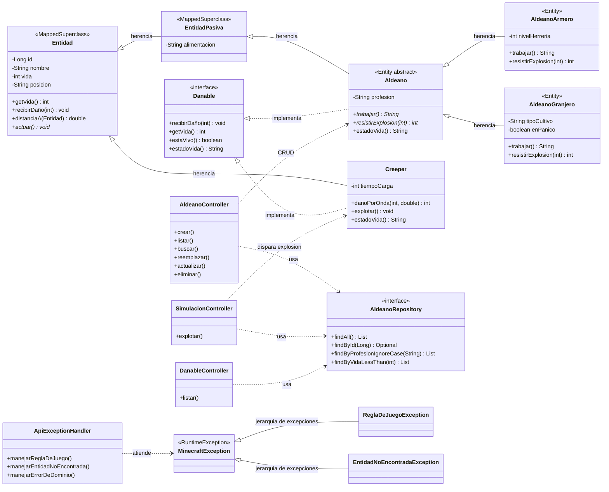

# arar-taller-git-2026 — POO-08: CRUD REST, H2, reglas de juego y excepciones

Servicio HTTP con Spring Boot sobre el modelado de **Minecraft**. Persiste en **H2** la familia de los aldeanos, expone un CRUD REST completo, ejecuta una simulación de explosión con dos reglas de negocio, y traduce una jerarquía de excepciones del dominio a respuestas HTTP distintas.

- **Autor:** Alexandre Avalos (`duw4ng`)
- **Dominio:** Minecraft
- **Commit de la solución:** <https://github.com/duw4ng/arar-taller-git-2026/commit/dafa0f16ae8194ddf0e505892a9be367eadb975b>
- **Enunciado:** <https://github.com/alefq/afq-taller-git-2024/blob/main/docs/ejercicio-poo-08-crud-h2-insomnia-2026-10-28.md>
- **Rúbrica:** <https://github.com/alefq/afq-taller-git-2024/blob/main/docs/RUBRICA-ejercicios-lp3-2026.md>

---

## 1. Cómo arrancar

```bash
./mvnw spring-boot:run
```

El servicio queda en <http://localhost:8080>. La colección de Insomnia se importa desde `insomnia/POO-08-arar-taller-git-2026.json`.

Comandos útiles:

```bash
./mvnw test          # prueba de contexto de Spring
./mvnw clean package # empaqueta target/arar-taller-git-2026-0.0.1-SNAPSHOT.jar
```

Para borrar los datos locales de H2, detener la aplicación y eliminar la carpeta `data/`.

---

## 2. Propiedades de H2 explicadas

Archivo: `src/main/resources/application.properties`.

| Propiedad | Valor | Qué significa |
|---|---|---|
| `spring.datasource.url` | `jdbc:h2:file:./data/entidades` | Base H2 en archivo, relativa al directorio del proyecto. El estado sobrevive a los reinicios. |
| `spring.datasource.username` | `sa` | Usuario de desarrollo de H2. |
| `spring.datasource.password` | vacío | H2 local sin contraseña; sólo para el taller. |
| `spring.datasource.driver-class-name` | `org.h2.Driver` | Driver JDBC que usa Spring para hablar con H2. |
| `spring.jpa.hibernate.ddl-auto` | `update` | Hibernate crea o actualiza las tablas según las entidades, sin borrar los datos existentes. |
| `spring.jpa.open-in-view` | `false` | La sesión JPA se cierra al terminar el servicio; evita consultas perezosas desde la vista y obliga a persistir dentro de la transacción. |
| `spring.jpa.show-sql` | `false` | No imprime el SQL generado. Se puede poner en `true` para depurar. |
| `spring.h2.console.enabled` | `true` | Habilita la consola web de H2. |
| `spring.h2.console.path` | `/h2-console` | URL de la consola. |

**Consola H2:** abrir <http://localhost:8080/h2-console>, usar `jdbc:h2:file:./data/entidades`, usuario `sa` y contraseña vacía. La tabla persistida se llama `aldeanos`. En Spring Boot 4 la consola ya no sale del driver H2: requiere la dependencia explícita `org.springframework.boot:spring-boot-h2console` (ver `pom.xml`); sin ese módulo las propiedades se ignoran y `/h2-console` da 404.

**Si mañana se cambia H2 por otra base:** se tocan `pom.xml` (driver), `application.properties` (URL, usuario, contraseña y dialecto) y, si se usa, la herramienta de migraciones. Las entidades, el repositorio, los servicios, los controllers y las reglas del dominio se quedan quietos.

---

## 3. Las tres clases persistidas y la interfaz

La familia persistida es:

- `Aldeano` — clase base abstracta, entidad JPA.
- `AldeanoArmero` — hija concreta, entidad JPA.
- `AldeanoGranjero` — hija concreta, entidad JPA.

La relación «es un» se mantiene: un armero y un granjero **son** aldeanos. El método abstracto `trabajar()` de POO-06 sigue existiendo y cada hija lo sobrescribe. La simulación agrega otro método abstracto, `resistirExplosion(int)`, también sobrescrito por las dos hijas.

La interfaz de dominio es **`Danable`**:

```java
public interface Danable {
    void recibirDaño(int cantidad);
    int getVida();
    boolean estaVivo();
    String estadoVida();
}
```

La implementan `Aldeano` (familia pasiva) y `Creeper` (familia hostil). El endpoint `GET /minecraft/danables` habla con el tipo `Danable`, no con las clases concretas.

### Diagrama Mermaid



Lectura del diagrama:

- **Herencia:** `Entidad → EntidadPasiva → Aldeano → AldeanoArmero/AldeanoGranjero`; `Entidad → Creeper`.
- **Implementación de interfaz:** `Aldeano` y `Creeper` implementan `Danable`.
- **Uso del repositorio:** los controllers dependen de `AldeanoRepository` (o del servicio que lo envuelve).
- **Jerarquía de excepciones:** `MinecraftException` es la base; `ReglaDeJuegoException` y `EntidadNoEncontradaException` son las hijas; `ApiExceptionHandler` atiende un tipo por método.

Por claridad, el diagrama muestra a `Creeper` colgando directamente de `Entidad`. En el código, `Creeper` hereda de `Entidad` a través de la clase abstracta `EntidadHostil`, que aporta los campos `daño` y `objetivo`.

---

## 4. API REST

| Método | URL | Qué hace | Éxito |
|---|---|---|---|
| `GET` | `/` | Confirma que el servicio vive. | `200` |
| `GET` | `/minecraft/trabajo` | Lista los mensajes polimórficos de `trabajar()` de lo persistido. | `200` |
| `POST` | `/minecraft/aldeanos` | Crea un aldeano; el `tipo` del JSON elige la hija. | `201 Created` |
| `GET` | `/minecraft/aldeanos` | Lista la colección persistida. Acepta `?profesion=Armero`. | `200` |
| `GET` | `/minecraft/aldeanos/{id}` | Lee un aldeano por su id. | `200` / `404` |
| `PUT` | `/minecraft/aldeanos/{id}` | Reemplaza el recurso entero. El tipo no puede cambiar. | `200` |
| `PATCH` | `/minecraft/aldeanos/{id}` | Actualiza sólo los campos presentes. | `200` |
| `DELETE` | `/minecraft/aldeanos/{id}` | Borra físicamente la fila. | `204 No Content` |
| `GET` | `/minecraft/danables` | Endpoint que usa la interfaz `Danable`. | `200` |
| `POST` | `/minecraft/simulaciones/explosion` | Ejecuta y persiste la simulación de explosión. | `200` |
| `GET` | `/h2-console` | Consola web de H2. | UI |

Ejemplo de creación:

```json
{
  "tipo": "ARMERO",
  "nombre": "Pedro",
  "vida": 20,
  "posicion": "5,64,0",
  "alimentacion": "Carne",
  "nivelHerreria": 3
}
```

El `id` **no** viaja en el JSON de creación: lo asigna H2/JPA y aparece en la respuesta y en la cabecera `Location`.

Para un granjero:

```json
{
  "tipo": "GRANJERO",
  "nombre": "Juan",
  "vida": 25,
  "posicion": "20,64,0",
  "alimentacion": "Pan",
  "tipoCultivo": "Trigo"
}
```

`PUT` exige todos los campos de base más el campo de la hija. `PATCH` sólo aplica los campos no nulos; un campo omitido conserva el valor anterior.

---

## 5. Las dos reglas de negocio

1. **Onda expansiva:** el daño que produce un Creeper es `potencia - distancia` (redondeado, nunca negativo) y es `0` para todo aldeano que esté fuera del radio de la explosión.
2. **Mitigación por oficio:** el armero reduce el daño en `nivelHerreria * 2` por su armadura, mientras que el granjero recibe el daño completo y, si sobrevive, queda marcado con `enPanico = true`.

Las dos reglas viven en el dominio:

- `Creeper.danoPorOnda(int potencia, double distancia)` implementa la onda expansiva.
- `AldeanoArmero.resistirExplosion(int)` y `AldeanoGranjero.resistirExplosion(int)` implementan la mitigación y el cambio de estado.

El controller de simulación sólo arma la petición, recorre los aldeanos persistidos, llama a esos métodos y guarda. El resultado queda en H2: un `GET /minecraft/aldeanos` posterior muestra la vida nueva y el `enPanico` del granjero.

Ejemplo de simulación:

```json
{
  "potencia": 30,
  "radio": 30,
  "posicionCreeper": "0,64,0",
  "tiempoCarga": 3
}
```

---

## 6. Jerarquía de excepciones y handlers

| Excepción | Situación | Handler | HTTP | `tipo` en el JSON |
|---|---|---|---|---|
| `MinecraftException` | Base del dominio; fallback. | `manejarErrorDeDominio` | `400` | `ERROR_DE_DOMINIO` |
| `ReglaDeJuegoException` | Se viola un invariante o una regla del juego. | `manejarReglaDeJuego` | `400` | `REGLA_DE_JUEGO` |
| `EntidadNoEncontradaException` | No existe el recurso pedido. | `manejarEntidadNoEncontrada` | `404` | `ENTIDAD_NO_ENCONTRADA` |

El JSON de error tiene esta forma:

```json
{
  "tipo": "REGLA_DE_JUEGO",
  "mensaje": "El nivel de herrería debe estar entre 1 y 5.",
  "estado": 400,
  "ruta": "/minecraft/aldeanos",
  "marcaTemporal": "2026-11-08T01:18:53.661289486"
}
```

Las excepciones son **no comprobadas** (`RuntimeException`). El dominio puede lanzarlas desde un constructor o un método sin obligar a declarar `throws` en toda la cadena; el `@RestControllerAdvice` las convierte en HTTP. Las hermanas se distinguen por el código (`400`/`404`) y por el campo `tipo`.

---

## 7. Sobrecarga y sobreescritura

### Sobreescritura (`@Override`, enlace dinámico en tiempo de ejecución)

- `trabajar()`: declarado abstracto en `Aldeano`, sobrescrito en `AldeanoArmero` y `AldeanoGranjero`. El controller lo invoca sobre `List<Aldeano>` sin conocer la hija.
- `resistirExplosion(int)`: declarado abstracto en `Aldeano`, sobrescrito en las dos hijas con reglas distintas. La simulación lo invoca sobre el tipo padre.
- `actuar()`: declarado en `Entidad`, sobrescrito en `Aldeano`, `Creeper`, `Jugador`, `Zombie`, `Esqueleto`, `Enderman` y `Cerdo`.
- `estadoVida()`: contrato de `Danable`; `Aldeano` y `Creeper` lo implementan con mensajes propios.

### Sobrecarga (misma clase, distinta firma, enlace estático en tiempo de compilación)

- **Constructores:** cada hija tiene un constructor sin argumentos `protected` para JPA, un constructor simple con algunos valores por defecto y un constructor completo con todos los datos.
- **Mensaje de dominio `comerciar()`:** `comerciar()` y `comerciar(String item, int cantidad)` en `Aldeano`.

| Criterio | Sobrecarga | Sobreescritura |
|---|---|---|
| Relación | Misma clase o jerarquía. | Requiere herencia. |
| Firma | Cambia la lista de parámetros. | Idéntica (nombre, parámetros, retorno). |
| Resolución | Compilación (*static binding*). | Ejecución (*dynamic binding*). |
| Anotación | No usa `@Override`. | Usa `@Override`. |
| Ejemplo | Constructores de `AldeanoArmero`/`AldeanoGranjero`; `comerciar()`. | `trabajar()` y `resistirExplosion()`. |

**Visibilidad del constructor vacío:** el constructor sin argumentos que necesita JPA se declara `protected`. Los constructores de negocio son `public` y validan. Así Hibernate puede instanciar la fila, pero el resto del código no puede fabricar un aldeano incompleto desde afuera.

---

## 8. Respuestas a «Qué hay que pensar»

**Recurso y verbo.** El sustantivo de la API es `aldeano`; la colección vive en `/minecraft/aldeanos` y el verbo HTTP dice la operación (`POST`, `GET`, `PUT`, `PATCH`, `DELETE`). La simulación es un recurso de proceso: `POST /minecraft/simulaciones/explosion`.

**Identidad.** La clave es `id`, un `Long` generado por la base con `GenerationType.IDENTITY`. Lo asigna H2/JPA; el JSON de creación lo omite y la respuesta lo incluye.

**Herencia y tablas.** Se eligió `InheritanceType.SINGLE_TABLE` con la columna discriminadora `tipo_aldeano`. La familia es chica, las hijas agregan pocos campos y casi todas las consultas piden «todos los aldeanos»; una sola tabla evita joins y mantiene el CRUD simple. En el JSON el subtipo se distingue con la propiedad `tipo`, agregada por Jackson con `@JsonTypeInfo` y `@JsonSubTypes` (`ARMERO`/`GRANJERO`).

**Interfaz y repositorio.** `AldeanoRepository` es una interfaz de Spring Data: se declaran los mensajes (`findAll`, `findById`, `findByProfesionIgnoreCase`, `findByVidaLessThan`) y el marco genera la implementación. El servicio depende del tipo interfaz, no de una clase concreta, así que puede probarse con un doble o cambiar de persistencia sin tocar el controller. Es la misma idea de POO-07: un contrato con mensajes, y alguien más pone la implementación.

**Protocolo del dominio.** La interfaz propia es `Danable`, con `recibirDaño`, `getVida`, `estaVivo` y `estadoVida`. La usan `Aldeano` (familia pasiva) y `Creeper` (familia hostil), y el endpoint `GET /minecraft/danables` la recorre como `List<Danable>`. Sí puede hablar con instancias de familias distintas: en la respuesta conviven armeros, granjeros y un Creeper.

**Ocultamiento.** Las reglas numéricas están en el dominio: constructores, setters validados y `@PrePersist`/`@PreUpdate`. `nivelHerreria` sólo acepta `1..5`; la vida nunca es negativa; una posición debe ser `x,y,z` numérica; `profesion`, `alimentacion` y `tipoCultivo` no pueden quedar vacíos. El `POST` ilegal del `nivelHerreria = 99` responde `400` antes de guardar, y la colección no crece: no aparece ninguna fila nueva en H2. El `@PrePersist` vuelve a validar si otra capa intentara persistir un estado imposible.

**PUT y PATCH.** `PUT` reemplaza el recurso entero: exige los campos base y el campo propio de la hija, y no permite cambiar el subtipo. `PATCH` actualiza un subconjunto: sólo cambia los campos presentes en el JSON; un campo omitido conserva el valor anterior.

**DELETE.** Borrar significa eliminar la fila (borrado físico) y responder `204`. Después, un `GET` por ese id da `404` con `EntidadNoEncontradaException`. El borrado habla con el dominio al buscar la entidad y con el repositorio al eliminarla; no hay una regla de juego que impida borrar.

**Dos reglas.** Los dos hechos que cambian el estado de más de un objeto a la vez son la onda expansiva (todos los aldeanos dentro del radio pierden vida según la distancia) y la mitigación por oficio (armeros y granjeros reaccionan distinto, y el granjero queda en pánico). El recurso es `POST /minecraft/simulaciones/explosion`. El `GET /minecraft/aldeanos` posterior muestra el resultado ya persistido.

**Excepciones.** `MinecraftException` es la base. `ReglaDeJuegoException` nombra el incumplimiento de una regla o invariante; `EntidadNoEncontradaException` nombra un recurso inexistente. Son tipos distintos porque el cliente debe poder reintentar de otra forma un `404` que un `400`. El JSON de error lleva `tipo`, `mensaje`, `estado`, `ruta` y `marcaTemporal`.

---

## 9. Colección de Insomnia

Archivo versionado: `insomnia/POO-08-arar-taller-git-2026.json`.

**Importar:** en Insomnia, `Application → Import/Export → Import Data → From File`, elegir el archivo JSON. Se crea el workspace «POO-08 - CRUD REST, H2 y simulacion (Minecraft)» con tres carpetas.

**Entorno:** seleccionar `Base Environment` y revisar:

- `baseUrl = http://localhost:8080`
- `aldeanoId = 1` (se actualiza con el id que devuelve el `POST`)

**Orden recomendado:**

1. `01 - CRUD de aldeanos / 00 - Servicio vivo`.
2. `01 - Crear armero`: copiar el `id` de la respuesta a `aldeanoId`.
3. `02 - Crear granjero` (opcional; crea la segunda hija).
4. `03 - Listar coleccion` y `04 - Buscar por id`.
5. `05 - Reemplazar (PUT)` y `06 - Actualizar parcial (PATCH)`.
6. `07 - Mensajes polimorficos trabajar()`.
7. `02 - Errores de dominio`: `01 - POST ilegal` (400 `REGLA_DE_JUEGO`), `02 - Id inexistente` (404 `ENTIDAD_NO_ENCONTRADA`), `03 - Simulacion ilegal` (400 `REGLA_DE_JUEGO`).
8. `03 - Interfaz y simulacion`: `01 - Endpoint de la interfaz Danable`, `02 - Simular explosion`, `03 - Ver estado persistido tras simular`.
9. `08 - Borrar` y repetir `04 - Buscar por id` para ver el `404`.

La colección cubre el CRUD, un `POST` ilegal, un id inexistente, el endpoint de la interfaz, la simulación en el caso feliz y un pedido por cada hija de la jerarquía de excepciones.

---

## 10. Estructura de paquetes

```
py.edu.uc.lp3.arar_taller_git_2026
├── ArarTallerGit2026Application.java
├── domain
│   ├── Entidad.java
│   ├── EntidadPasiva.java
│   ├── Aldeano.java
│   ├── AldeanoArmero.java
│   ├── AldeanoGranjero.java
│   ├── Creeper.java
│   ├── Danable.java
│   ├── EntidadHostil.java
│   └── exception
│       ├── MinecraftException.java
│       ├── ReglaDeJuegoException.java
│       └── EntidadNoEncontradaException.java
├── repository
│   └── AldeanoRepository.java
├── service
│   ├── AldeanoService.java
│   └── SimulacionService.java
└── rest
    ├── controller
    │   ├── AldeanoController.java
    │   ├── SimulacionController.java
    │   ├── DanableController.java
    │   ├── IndexController.java
    │   └── ApiExceptionHandler.java
    └── dto
        ├── AldeanoRequest.java
        ├── AldeanoPatchRequest.java
        ├── ExplosionRequest.java
        ├── ExplosionResponse.java
        ├── ResultadoAldeano.java
        └── ErrorResponse.java
```

El dominio no conoce HTTP ni JPA más allá de las anotaciones de mapeo. El controller traduce HTTP; el repositorio traduce filas; las reglas del juego viven en las clases del dominio.

---

## 11. Cómo probar en cinco minutos

1. `./mvnw spring-boot:run`.
2. `GET /` → `200`.
3. `POST /minecraft/aldeanos` con el armero válido → `201` y un `id`.
4. `GET /minecraft/aldeanos` → el armero aparece.
5. `GET /minecraft/aldeanos/{id}` → coincide.
6. `PUT` o `PATCH` → el campo cambia y sigue cambiado después de otro `GET`.
7. `POST` ilegal (`nivelHerreria: 99`) → `400`; la colección no creció.
8. `DELETE /minecraft/aldeanos/{id}` → `204`; el `GET` posterior da `404`.
9. `GET /minecraft/danables` → mensajes de la interfaz con armeros, granjeros y un Creeper.
10. `POST /minecraft/simulaciones/explosion` → vida reducida y `enPanico`; el `GET` posterior lo confirma.
11. Cada excepción hija: `POST` ilegal (`400 REGLA_DE_JUEGO`) e id inexistente (`404 ENTIDAD_NO_ENCONTRADA`).

Consola H2: <http://localhost:8080/h2-console>, JDBC URL `jdbc:h2:file:./data/entidades`, usuario `sa`, contraseña vacía. La tabla `aldeanos` muestra el estado persistido.

---

## 12. Bitácora de IA

Ver [`BITACORA.md`](BITACORA.md).
